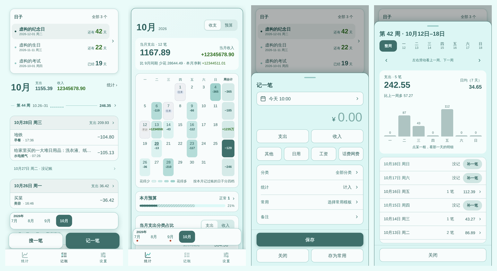
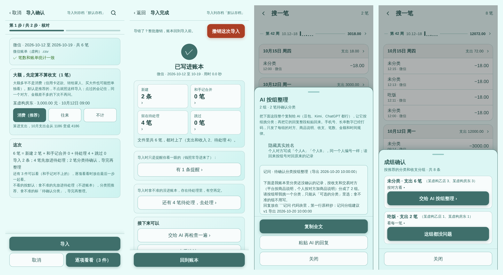
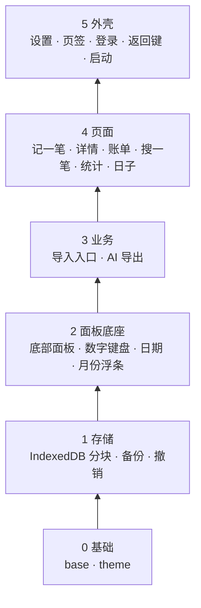
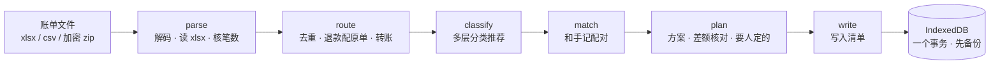

# 记问 · 会自己对账的安卓记账本

> 手记一笔只要几秒；月底把微信、支付宝账单整段导进来，自动和手记对上、不重复；几百笔分类交给你自己用的 AI 一次整理完。数据只存在手机里，记问自己不联网。

   





<sub>截图里的数据全部是虚构的测试数据。</sub>

**[下载最新测试版 APK](https://github.com/topukk45-arch/baofu-ledger/releases/download/latest-build/jiwen-latest.apk)** · [所有版本](https://github.com/topukk45-arch/baofu-ledger/releases) · 正式版 [记问 1021 β](https://github.com/topukk45-arch/baofu-ledger/releases/download/v1021-beta/jiwen-1021-beta.apk)

---

## 解决什么问题

记账 App 的老问题：**手记会漏，导账单又会重复、分类全乱**。一年的微信 + 支付宝账单两千多笔，里面混着退款、转账、红包、零钱提现、信用卡还款；导进来以后最费事的是逐笔分类。

记问的做法：

| 难点 | 记问怎么处理 |
|---|---|
| 账单和手记重复 | 按时间、金额、对方一层一层配对，能确定的自动合并成一条；拿不准的进「待处理」让人定，不猜 |
| 退款、转账乱算 | 退款自动挂回原单、全额退款的一对直接跳过；转账、提现、还款单独一类，不算进收支 |
| 分类太多看不过来 | 规则 → 从你的历史里学 → 内置词表 → 支付宝分类，逐层推荐；剩下拿不准的**按组**交给 AI，一次整理几百笔 |
| 导错了怎么办 | 每次导入、每次 AI 修改都先自动备份，能整批撤销；撤销会算依赖链，后来改过的不动 |
| 隐私 | 不联网、不接任何 AI 接口；复制给 AI 之前自动打码，可以把个人姓名换成「个人A / 个人B」 |

实测：一次导入一年的真实账单，**绝大部分能靠「AI 按组整理」一次分好类**，剩下几笔在「成组确认」里点几下。

## 功能

- **记账**：一屏记完（数字键盘、最近常用分类、常用模板）；记完底部小条能「再记一笔」；长按一笔改 / 删，删了 5 秒内能撤销。
- **账单页**：按月、按周、按天三层；没记账的日子标出来、一点补一笔；月份浮条左右拨切月。
- **统计**：日历热力四档、周合计、分类占比和上月同期比较、预算进度（带「时间过了多少」的斜纹）、总结余算式展开。
- **搜一笔**：日期 / 金额 / 收支 / 分类 / 统计口径 / 备注多选组合，最近搜过，搜到的能批量改（可撤销）。
- **账单导入**（开发开关里，测试中）：微信 xlsx、支付宝 CSV、加密压缩包；分步核对；只对账；待处理；导入记录与撤销；备份恢复。
- **AI 按组整理**：导出一段结构化文字 → 用户自己贴给任意 AI → 粘回回复 → 每组一张卡勾选确认 → 写入并可撤销。
- **外观**：24 个预设主题色 + 自定义取色，所有文字在每个主题下都满足 4.5:1 对比度。
- **备份**：导出存档文件、连自己的 OneDrive 自动备份。

## 技术亮点

### 1. 无框架的模块化前端，依赖方向由测试锁死

原生 JavaScript（不用 React / Vue），约 2.2 万行业务代码，拆成 25 个模块，分 6 层：



- 每个模块一个 IIFE、对外只有一个 `window.JiwenXxx` 入口；**只许调用下层**，往上的调用只有登记过的三种回调口。
- 依赖规则写成测试（语法树扫描 + 真起 App 检查全局变量），新代码越层、漏出全局名字，CI 直接拦下。
- 这套结构是从一个 800 KB 的单文件**分 26 步原样搬出来的**：每一步逐字节对比页面输出、全部测试通过，不改一行逻辑。

### 2. 账单导入：纯函数流水线 + 后台线程



- 每一步都是**纯函数**（不碰页面、存储、网络），浏览器、Web Worker、Node 测试里用同一份代码；计算在后台线程跑，界面不卡。
- 笔数和金额**对账到分**：每个文件 × 收支的差额拆开解释，合计必须差 0 分，对不上不让往下走。
- 读 xlsx、解 WinZip AES 加密包：SHA-1、HMAC、PBKDF2、AES 都是自己写的 JS，不依赖 WebCrypto 和第三方库（解压用 tiny-inflate）。
- 撤销不是简单回滚：`undo.js` 算出批次之间的**依赖链**（后一次导入合并了这批的记录、AI 改过这批的记录……），从新到旧撤；导入后你亲手改过的字段，按字段级指纹认出来、保留不动。

### 3. 把 AI 当成「用户自己的工具」，而不是接口

记问不调用任何 AI API。导出给 AI 的是一段**协议化的文字**，AI 的回复按协议读回来：

- **按组压缩**：同一商户 / 同一收支归一组，每组带统计特征（平均每笔、单笔范围、日期范围、常见时段、工作日或周末、疑似月固定扣款），几百笔变成几十行，AI 一次看得完、判断有依据。
- **固定回复格式**：第一行抄导出时间戳（防止拿旧回复改新数据），一行一组「G号 | 分类 | 理由」；分类不在白名单、格式不对的行单独列出来，不会乱改。
- **隐私**：手机号、卡号、邮箱打码；可选把个人对方换成稳定的别名，读回时按组号对回原记录。
- **可撤销**：写入走和导入同一套「先备份、一个事务、能撤销」。

### 4. 启动速度：首屏快照

大脚本解析完才能画界面，低端机上要几百毫秒。做法是把用户最后看到的首屏 HTML 存下来，下次启动在脚本跑之前先画出来，原生启动画面等这一帧画好才收；真界面画好后无缝替换。每次启动的各段耗时（含原生层：进程启动 → Activity → WebView → 首屏）记在 App 内的性能记录里，用真机数据而不是猜测来调。

### 5. 测试：186 组、6200 多条，测试不过不出包

| 层次 | 做法 |
|---|---|
| 整页功能 | jsdom 在 Node 里跑完整 App，模拟点击、键盘、返回键、IndexedDB |
| 逐字节回归 | 新旧两版同样的操作，账单列表、统计、备份文件、AI 导出逐字节比 |
| 导入标准答案 | 固定的虚构账单真导一遍，和存好的结果逐字节比 |
| 性质测试 | 随机组合「记账 / 导入 / 撤销 / 恢复 / AI 修改」，每步查各处数据对得上（CI 每次跑几十步，本地可调到几百步） |
| 规模 | 12 万条记录进账号、记一笔、切统计页的耗时 |
| 真浏览器界面检查 | Playwright + Chromium 按手机尺寸逐页量：点击区 ≥ 48px、按钮被盖住 / 被切半截、字被截断、24 个主题的对比度 |

GitHub Actions：推到 main → 跑全部测试 → 打 APK → 自动发布；测试有一条不过就不出包，失败条目直接标在 Actions 页面上。

## 项目数据

- 业务代码：JavaScript 约 2.2 万行（App 1.3 万 + 导入 0.9 万）、CSS 约 2500 行；原生层 3 个自写的 Capacitor 插件（启动画面、「用记问打开」账单文件、OneDrive 登录）
- 测试代码：约 2.5 万行，186 个测试文件
- 依赖：运行时只有 Capacitor 和 tiny-inflate，没有前端框架

## 怎么做出来的

需求、交互设计、真机实测和每一版的验收由作者完成；代码在 AI 编程助手（Claude Code）协作下完成。为了让 AI 写的代码可控，项目把规矩写成了能执行的东西：

- [CLAUDE.md](CLAUDE.md)：每个模块、每条交互规则、每种数据怎么存怎么撤，写成大白话，改代码前先读、改完同步更新；
- 「操作 × 数据表」：哪个操作会改哪份数据，加功能必须更新，性质测试按这张表随机组合检查；
- 测试只增不减、不许放宽；动数据的改动一版只做一件事；每一轮有交接文档 [HANDOFF.md](HANDOFF.md) 和发版说明。

## 跑起来

```bash
# 跑测试
cd tests && npm install && npm test

# 两个版本逐字节对比页面输出
node tests/regress.js 旧版.html www/index.html

# 真浏览器界面检查（要装 Playwright 的 Chromium）
NODE_PATH=$(npm root -g) node tests/ui/audit.js 输出目录 --only main --shots
```

打包：推到 main 后 GitHub Actions 自动出 APK（Actions →「构建安卓 APK」→ Artifacts），也可以在 Actions 页面手动 **Run workflow**。本地不需要装 Android Studio。

目录：`www/index.html` 页面骨架 · `www/app/` 主程序模块 · `www/import/` 账单导入（打开导入时才加载） · `android/` 原生壳 · `tests/` 测试。详见 [tests/README.md](tests/README.md)。

## 说明

- 产出的是 debug 签名的 APK，适合自己装着用；各版本签名一致，可以直接覆盖安装，账本不动。
- 账单导入、AI 按组整理等功能还在开发开关里（设置页最底下的版本号 2 秒内连点 5 次）。拿自己的账本试之前，先在「设置 → 导出存档」备份一份。
- 包名沿用 `com.baofu.ledger`，为了新版能直接覆盖旧版、不丢数据。

## 许可证 / License

© 2026 Yake（[topukk45-arch](https://github.com/topukk45-arch)）。

本项目以 [PolyForm Noncommercial 1.0.0](LICENSE) 授权：可以自由学习、个人使用和修改，**禁止任何商业用途**。如需商用，请先联系作者。项目中引用的第三方字体、图标、库及其他素材，仍按其各自的许可证授权。

This project is licensed under the [PolyForm Noncommercial License 1.0.0](LICENSE). Commercial use is not permitted.

### 致谢

- 底栏文字字体：[霞鹜文楷 LXGW WenKai](https://github.com/lxgw/LxgwWenKai)（SIL OFL 1.1）
- 图标：[Lucide](https://lucide.dev)（ISC）、[Tabler Icons](https://tabler.io/icons)（MIT）
- 解压：[tiny-inflate](https://github.com/foliojs/tiny-inflate)（MIT，Devon Govett），原样收录在 `www/import/vendor/tiny-inflate.js`
